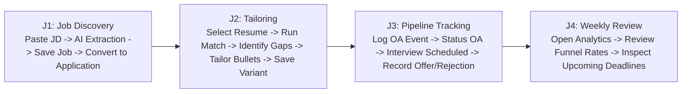
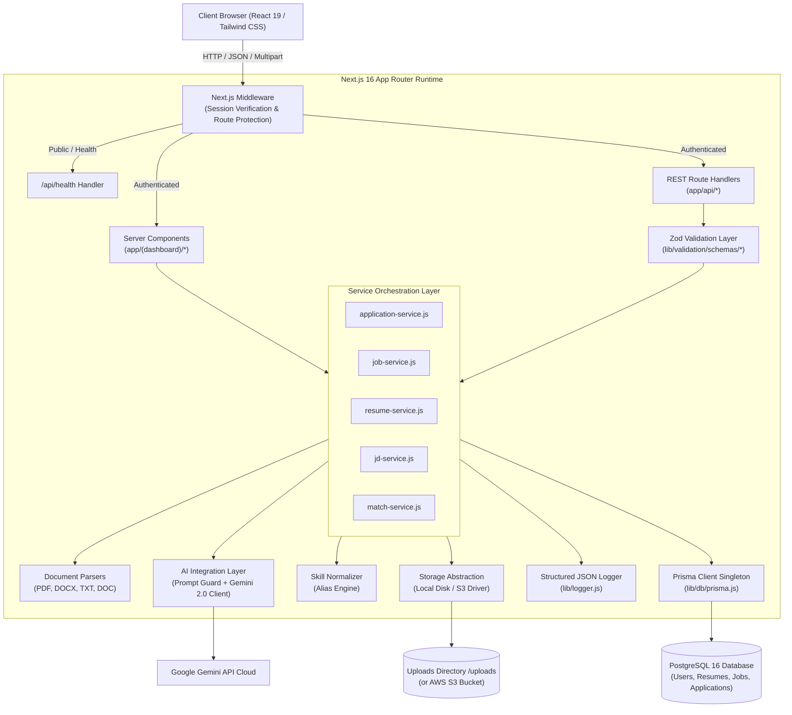
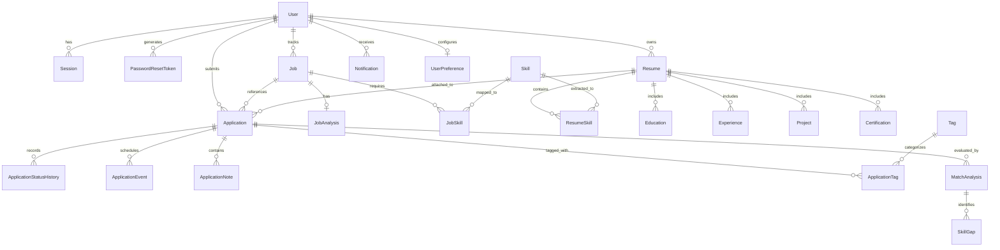
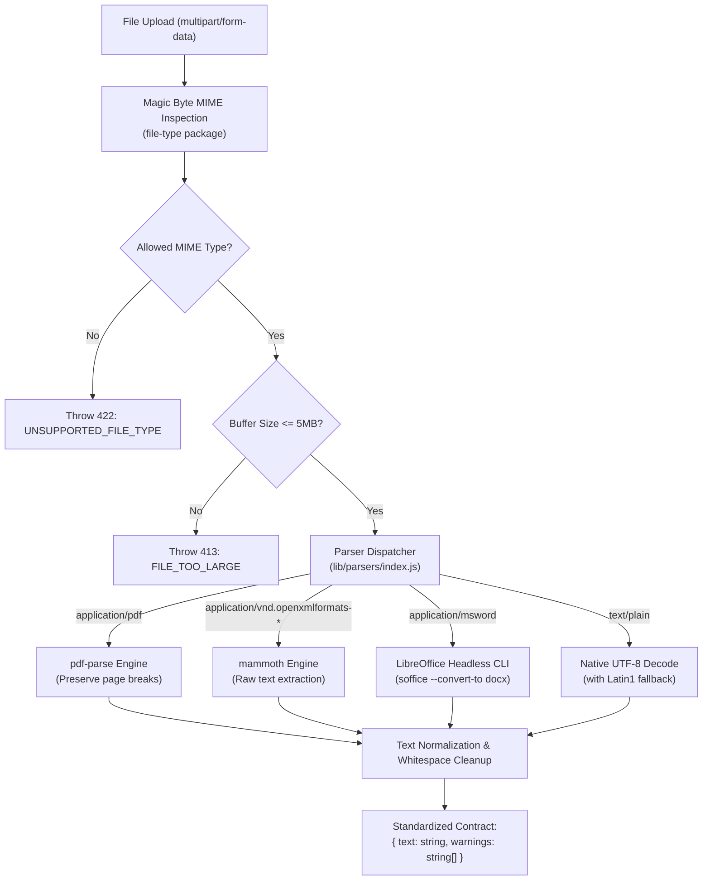
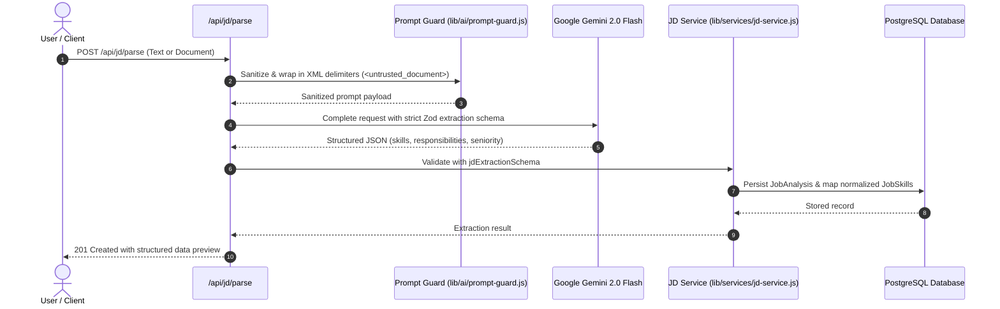
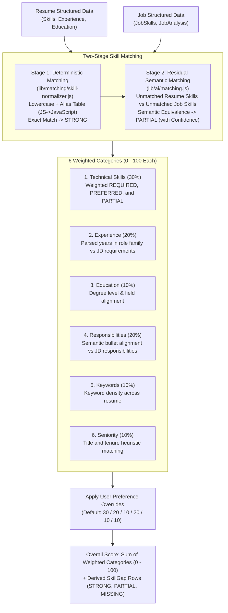
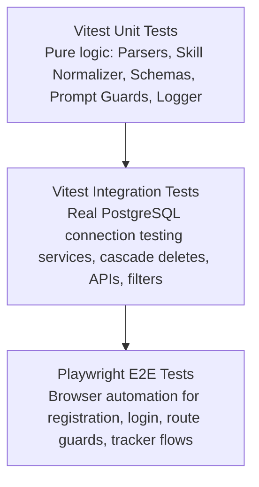

# JobOS — Master Plan

Version: 1.1  
Status: Governing architecture and product specification — single source of truth for design, domain models, and technical standards.  
Last Updated: November 2026 (Audited and aligned with active codebase).

---

## 1. Executive Summary

JobOS is an intelligent, single-tenant personal **Job Search Operating System** built as a unified Next.js 16 application (App Router, JavaScript/JSX only) backed by PostgreSQL via Prisma ORM. It guides a job seeker through finding a role, saving it, parsing job descriptions (JDs) with Google Gemini AI, parsing multi-format resumes, computing an explainable resume↔JD match score, tracking applications through multi-stage pipelines (OA, technical interviews, offers), and viewing career analytics.

The system is designed to run either natively on a developer machine (Node.js + local PostgreSQL) or containerized via a multi-stage Dockerfile and Docker Compose. AI capabilities (JD extraction, semantic skill matching, resume bullet tailoring) are isolated behind a strict server-side boundary layer in `lib/ai/`, guarded by prompt injection sanitization and strict Zod runtime schema validation.

Crucially, **the match score is never an arbitrary LLM hallucination**: it is computed deterministically by domain logic over normalized, AI-extracted structured data. The project is implemented in 11 sequential phases, each gated by automated unit, integration, and E2E tests, clean linting, and CI pipelines before merging to `main`.

---

## 2. Product Vision

Give a job seeker one unified system of record for their entire job search—replacing fragile spreadsheets, bookmarks, and scattered notes—with targeted AI assistance to eliminate repetitive drudgery (parsing, comparing, drafting) while keeping the user in full control of every claim and bullet point submitted on their resume.

---

## 3. Product Goals & Non-Goals

### Product Goals
1. **Single Source of Truth**: Consolidate jobs, resumes, applications, interview timeline events, and notes into one cohesive relational database.
2. **Explainable, Auditable Match Scoring**: Transparent scoring across 6 independent dimensions (technical skills, experience, education, responsibilities, keywords, seniority). Never return an opaque, unexplainable black-box percentage.
3. **Strict Anti-Fabrication**: AI assists with structuring, analyzing, and phrasing, but is strictly constrained from fabricating metrics, employers, skills, or job titles.
4. **Fast, Server-Side Querying**: Sub-300ms p95 response time for paginated, indexed searches, status filters, and multi-field sorting over thousands of applications.
5. **Flexible Execution Architecture**: Native local execution with Node.js and PostgreSQL alongside full containerization via Docker and automated GitHub Actions CI/CD.
6. **Incrementally Shippable**: Every phase produces a standalone, functional, and fully tested increment.

### Non-Goals (MVP Scope)
- **Not a Job Board**: No web scraping, automated web crawling, or bulk aggregation of external job listings.
- **Not an ATS Clone**: We do not claim proprietary ATS algorithmic parity; JobOS measures alignment against stated requirements.
- **Not Multi-Tenant Enterprise Software**: Single-user architecture per deployment (no team collaboration, billing, or multi-tenant RBAC in MVP).
- **No Native Mobile App**: Fully responsive, mobile-optimized web UI.
- **No Real-Time Chat**: Asynchronous event tracking and notifications without WebSocket overhead.

---

## 4. Current State vs. Target

```
[Phases 01 - 06: Completed]  ==>  [Phase 07: In Progress]  ==>  [Phases 08 - 11: Planned / Target]
- Auth & Session (Auth.js)         - Skill Normalizer (Done)       - Resume AI Assistant (Phase 08)
- Job Management & CRUD            - Match Prisma Models (Done)    - Career Analytics (Phase 09)
- Application Tracker & Timeline   - Semantic Matching (WIP)       - Notifications & Reminders (Phase 10)
- Multi-format Resume Ingestion    - 6-Category Scorer (WIP)       - Production Vercel/AWS Deploy (Phase 11)
- Gemini JD AI Extraction          - Match Analysis UI (Next)
- Docker, CI/CD, Observability
```

| Subsystem | Current Implemented State (November 2026) | Target End-State (Post-MVP) |
| :--- | :--- | :--- |
| **Authentication** | Credentials login, registration, session cookies, route protection, reset API endpoints. | Add frontend password reset UI forms, OAuth providers (GitHub/Google), live email dispatch via SES/Resend. |
| **Job Management** | Full CRUD, salary/location fields, archive toggle, 1-click convert to application. | Browser extension for 1-click job capture from LinkedIn/Indeed. |
| **Applications** | Table view, status filtering, multi-field search, pagination, events, notes, tags. | Interactive Kanban board view, drag-and-drop status pipelines. |
| **Resume Parsing** | PDF, DOCX, TXT, DOC parser dispatch, magic-byte checking, local file storage. | Async BullMQ worker queue, AWS S3 storage provider option. |
| **JD Extraction** | Gemini 2.0 Flash AI pipeline with prompt guards, schema validation, and structured output. | In-depth company profile extraction and industry keyword benchmarking. |
| **Matching Engine**| `MatchAnalysis`/`SkillGap` schema, skill normalizer with alias tables. | Full 6-category score engine, residual semantic matcher, transparent gap UI. |
| **Resume Assistant**| API route stubbed (`/api/ai/tailor-bullet`). | Anti-fabrication bullet rewriter with diff-based side-by-side approval UX. |
| **Analytics** | Schema models in place (`ApplicationStatusHistory`). | Visual conversion funnels, response rate analytics, time-to-offer charts. |
| **Notifications** | Prisma `Notification` model with scheduled reminder fields. | Background polling worker (`node-cron`), in-app notification center, desktop alerts. |
| **DevOps & Quality** | Vitest (82.5% coverage), Playwright E2E, Docker multi-stage, GitHub Actions CI, `/api/health`. | Automated production deployments to Vercel or AWS ECS with CloudWatch logging. |

---

## 5. Prioritized Roadmap

1. **Phase 07 — Resume/JD Matching Engine (Active Focus)**
   - Complete `lib/ai/matching.js` for residual semantic skill pairing.
   - Complete deterministic 6-category score engine (`lib/matching/score-engine.js`).
   - Implement user preference weight overrides (`lib/matching/weights.js`).
   - Implement match service orchestrator and `/api/match` endpoints.
   - Build Match Analysis UI breakdown (`/analysis/[applicationId]`) with skill gap badges (`✓ Strong`, `~ Partial`, `✗ Missing`).

2. **Phase 08 — Resume AI Assistant**
   - Anti-fabrication prompt guardrails preventing false metric generation.
   - Bullet point optimizer and tailored suggestion service (`lib/ai/resume-writing.js`).
   - Side-by-side diff review UI with explicit manual approval before saving.

3. **Phase 09 — Analytics & Reporting**
   - Pipeline funnel analytics (Saved → Applied → Interview → Offer conversion).
   - Time-in-stage calculations and interview velocity metrics.
   - Responsive chart visualizations (Recharts or SVG-based).

4. **Phase 10 — Events & Notifications**
   - Scheduled event reminders (OA deadlines, technical screens).
   - In-app notification center dropdown and unread badge.
   - In-process background reminder scheduler (`node-cron`).

5. **Phase 11 — Production Hardening & Cloud Deployment**
   - Production deployment to Vercel or containerized deployment to AWS (ECS/Fargate).
   - Rate limiting on authentication and AI endpoints.
   - Security audit, cross-user isolation verification, and database backup automation.

---

## 6. Target User & User Journeys

### Target User
An engineer or technical job seeker actively applying to multiple positions across startup and enterprise tech, maintaining specialized resume variants, and needing to track deadlines, interview stages, and tailoring per application.

### Core User Journeys



- **J1 — New Job Discovered**: User pastes a raw JD or uploads a PDF → JobOS extracts requirements via Gemini AI → user saves it as a Job → converts it to an Application (status `SAVED`).
- **J2 — Tailor Before Applying**: User selects a Resume variant + Job → runs Match Analysis → inspects skill gaps → uses AI bullet assistant to tailor experience bullets → saves new resume version → transitions status to `APPLIED`.
- **J3 — Track Through Pipeline**: User receives an Online Assessment (OA) invitation → logs an Event → status transitions to `OA` → technical interview scheduled → outcome recorded (`OFFER`, `REJECTED`, or `GHOSTED`).
- **J4 — Weekly Review**: User opens Analytics dashboard → reviews interview conversion rates, response velocity, and upcoming interview deadlines.

---

## 7. Complete Feature Inventory

1. **Authentication & Identity**: User registration, bcrypt password hashing, Auth.js credentials provider, database session management, route protection middleware, password reset API, email verification tokens.
2. **Job Management**: Full CRUD, salary range and currency tracking, location and employment type, job source, soft-archiving, one-click conversion to application.
3. **Application Lifecycle Tracker**: 10 distinct status stages, server-side pagination, text search, status filters, multi-column sorting, detailed timeline history, notes, colored tags, scheduled interview events.
4. **Document Ingestion**: Multi-format parser engine for PDF, DOCX, DOC, and TXT with magic-byte MIME validation, 5MB file size limits, and local storage provider abstraction.
5. **JD Analysis & AI Extraction**: Google Gemini 2.0 Flash integration, prompt injection delimiters, structured Zod validation, extraction of responsibilities, qualifications, technical skills, and seniority.
6. **Matching & Gap Engine**: Skill normalizer with alias table, deterministic 6-category scoring algorithm, residual semantic skill pairing, user weight overrides, skill gap breakdown (`STRONG`, `PARTIAL`, `MISSING`).
7. **AI Resume Assistant**: Anti-fabrication guardrails, bullet point improvement, diff-based side-by-side approval UX.
8. **Observability & Diagnostics**: Structured JSON logging (`lib/logger.js`) with request context, and unauthenticated `/api/health` database probe.
9. **DevOps & Containerization**: Multi-stage Dockerfile with Next.js standalone server, Docker Compose stack with PostgreSQL 16, GitHub Actions CI workflow, Vitest v8 coverage reporting (82.5% statement coverage).

---

## 8. MVP Scope vs. Post-MVP Backlog

- **MVP (Phases 01–10 + Hardening Phase 11)**: Core tracking, document parsing, Gemini JD extraction, deterministic matching, bullet tailoring, timeline events, in-app notifications, and basic analytics.
- **Phase 2 (Post-MVP)**: Customizable status pipelines (schema migration to status definition table), live email dispatch via AWS SES / Resend, resume PDF export from structured JSON, recruiter CRM, browser extension for one-click job capture from LinkedIn/Indeed.
- **Future (Phase 3)**: Team workspaces, interview question bank, calendar sync (Google/Outlook), Elasticsearch integration for massive datasets, S3/R2 storage driver, BullMQ/Redis async worker queue.

---

## 9. Technology Stack & Justification

| Layer | Choice | Justification | Trade-offs & Mitigations |
| :--- | :--- | :--- | :--- |
| **Framework** | Next.js 16 (App Router) | Single deployment unit; Server Components eliminate client data waterfalls; Route Handlers provide clean REST endpoints. | Framework coupling; mitigated by isolating domain logic in framework-agnostic `lib/services/`. |
| **Language** | JavaScript (ES2024 / JSX) | Strict project rule; standard modern JS with zero compilation step required for server scripts; plain JS runtime ergonomics. | Lack of static type checking; mitigated by strict Zod schema validation on all inputs and data boundaries. |
| **ORM** | Prisma 5 | Declarative schema modeling, automated migrations, type-safe query generation via JSDoc, seamless relation cascades. | Small cold-start overhead; mitigated by connection pooling in singleton `lib/db/prisma.js`. |
| **Database** | PostgreSQL 16 | ACID transactions for status history cascades, composite indexes for fast list queries, `pg_trgm` fuzzy text search. | Requires PostgreSQL instance; mitigated by Docker Compose automated containerization. |
| **Auth** | Auth.js (NextAuth v5 beta) | Battle-tested session management, CSRF mitigation, database session persistence enabling server-side revocation. | Extra database lookup on authenticated requests; mitigated by indexed `Session.sessionToken`. |
| **AI / NLP** | Google Gemini 2.0 Flash | Ultra-fast token latency, high structured JSON accuracy, cost efficiency for JD analysis and skill extraction. | Cloud API dependency; mitigated by isolating calls in `lib/ai/`, retry logic, and fallback parsing. |
| **Document Parsers**| `pdf-parse`, `mammoth`, `soffice` | Pure-JS extraction for PDF and DOCX; LibreOffice headless CLI probe for legacy binary `.doc` files. | External binary dependency for `.doc`; mitigated by startup probe probe and 422 error explanation. |
| **Testing** | Vitest + Playwright | Vitest provides sub-second ESM unit test execution with native v8 coverage; Playwright guarantees real browser E2E verification. | Maintaining two test runners; mitigated by unified npm scripts and CI pipeline integration. |
| **DevOps** | Docker & GitHub Actions | Reproducible multi-stage Alpine containers, Next.js standalone output, automated CI test and coverage gates. | Container footprint; mitigated by multi-stage builds excluding dev dependencies and build caches. |

---

## 10. System Architecture & Request Flow



---

## 11. Folder Structure & Modular Organization

```text
jobOS/
├── app/                        # Next.js App Router
│   ├── (auth)/                 # Authentication routes (login, register, reset-password)
│   ├── (dashboard)/            # Authenticated application views
│   │   ├── layout.jsx          # Topbar, navigation sidebar, and session guard
│   │   ├── page.jsx            # Dashboard metrics overview
│   │   ├── applications/       # Application tracker table, detail, creation, editing
│   │   ├── jobs/               # Job inventory, creation with JD analysis, detail views
│   │   ├── resumes/            # Resume list, multi-format upload dropzone, viewer
│   │   ├── analysis/           # Match score and skill gap breakdown views
│   │   └── settings/           # User preferences and account management
│   ├── api/                    # REST API Route Handlers
│   │   ├── applications/       # Application CRUD, status, notes, events, tags
│   │   ├── auth/               # NextAuth endpoints, password reset, email verification
│   │   ├── health/             # Database connectivity health probe
│   │   ├── jd/parse/           # Multipart and text JD extraction endpoint
│   │   ├── jobs/               # Job CRUD and convert-to-application endpoints
│   │   ├── resumes/            # Resume upload, metadata retrieval, download endpoints
│   │   ├── match/              # Resume↔JD match calculation endpoints
│   │   └── ai/                 # AI assistant endpoints (tailor-bullet)
│   └── layout.js               # Global application layout and styles
├── components/                 # Reusable UI primitives and domain widgets
│   ├── jobs/                   # Job forms, filter bars, conversion buttons
│   ├── resumes/                # Resume upload dropzone, list cards, detail viewers
│   ├── tracker/                # Application tables, filters, status selects, timeline, notes
│   └── ui/                     # Accessible primitives (Button, Dialog, Input, Select, Table, Toast)
├── features/                   # Complex multi-component feature modules
│   ├── auth/                   # LoginForm, RegisterForm components
│   ├── jd-analysis/            # JDInputPanel, ExtractionResults components
│   └── matching/               # MatchScoreCard, SkillGapList components
├── lib/                        # Core system services, domain utilities, and integrations
│   ├── ai/                     # Gemini provider client, prompt guards, JD extraction prompts
│   ├── auth/                   # NextAuth config, password hashing, session extractors
│   ├── db/                     # Prisma database client singleton
│   ├── matching/               # Skill normalizer, alias tables, score engine
│   ├── parsers/                # Document parsers (PDF, DOCX, TXT, DOC contract & implementations)
│   ├── services/               # Application, job, resume, JD, event, note, tag services
│   ├── storage/                # Abstract storage provider and local filesystem driver
│   ├── utils/                  # Structured logger, custom error classes, pagination helpers
│   └── validation/schemas/     # Zod validation schemas for all domain resources
├── prisma/                     # Database schema definition and migration files
├── tests/                      # Automated test suites
│   ├── e2e/                    # Playwright browser end-to-end specifications
│   ├── fixtures/               # Sample resumes, test PDFs, and mock payloads
│   ├── integration/            # Service and database integration test suites
│   └── unit/                   # Fast isolated unit tests (Vitest)
├── .github/workflows/          # GitHub Actions CI workflow definitions
├── docker-compose.yml          # Container configuration for app and PostgreSQL
└── Dockerfile                  # Multi-stage production container build
```

---

## 12. Database Architecture & Complete Data Model



### Relational Cascade Strategy
- **Parent Deletion (`onDelete: Cascade`)**: Child entities that possess no meaning outside their parent cascade automatically (e.g., `User` deletion deletes their `Job`s, `Resume`s, and `Application`s; `Application` deletion deletes its `ApplicationStatusHistory`, `ApplicationEvent`s, and `ApplicationNote`s).
- **Referential Protection (`onDelete: SetNull`)**: When a `Resume` or `Job` linked to an active `Application` is deleted, the foreign keys on `Application` are set to `null` (`onDelete: SetNull`), preserving application history and interview records.
- **Normalized Skills**: Both `ResumeSkill` and `JobSkill` connect to a canonical `Skill` model featuring unique `normalizedName` constraints, preventing duplicate representations of identical skills.

---

## 13. Document Ingestion & Multi-Format Parsing Architecture



---

## 14. Job Description (JD) Extraction Pipeline



---

## 15. Resume↔JD Matching Engine & 6-Category Scoring

The JobOS Matching Engine is a **hybrid deterministic algorithm**: it never permits an LLM to guess an arbitrary match percentage.



---

## 16. AI Safety, Guardrails & Anti-Fabrication

1. **Untrusted Data Boundary**: Resume text and job description content are treated as untrusted data. They are never concatenated directly into system instructions. User documents are wrapped inside `<untrusted_document>` XML tags with explicit instructions directing the model to treat the content solely as data.
2. **Strict Anti-Fabrication in Bullet Tailoring**: When suggesting bullet optimizations (`lib/ai/resume-writing.js`), the prompt forbids introducing unverified companies, dates, or metrics. Where a metric is missing, the assistant outputs placeholder tokens (e.g., `[ADD METRIC: % improvement]`). Server-side validation inspects output for ungrounded numbers.
3. **Diff-Based Manual Approval**: AI suggestions are presented side-by-side with original bullets. No AI modification is ever applied automatically to stored resumes without explicit user confirmation.
4. **Schema Enforcement**: Every AI response must pass Zod schema validation before saving to PostgreSQL. Malformed responses trigger automated retries before failing gracefully.

---

## 17. Observability, Diagnostics & Health Monitoring

1. **Structured JSON Logging (`lib/logger.js`)**: All application events, warnings, and errors emit machine-readable JSON logs:
   ```json
   {
     "timestamp": "2026-11-15T16:44:19.123Z",
     "level": "INFO",
     "message": "Application created successfully",
     "userId": "usr_clx123",
     "applicationId": "app_clx456",
     "company": "Google",
     "role": "Software Engineer"
   }
   ```
2. **Context Binding**: Child loggers (`logger.child({ requestId, service })`) allow tracing requests through service and parser layers.
3. **Health Check Endpoint (`GET /api/health`)**: Publicly accessible probe executing `SELECT 1` on the PostgreSQL pool. Returns `200 OK` with latency metrics when healthy, or `503 Service Unavailable` with diagnostics when the database is disconnected.

---

## 18. Testing Strategy & Measured Code Coverage

The automated test pyramid spans three distinct tiers:



### Measured Test Coverage (Vitest v8)
- **Statement Coverage**: `85.07%`
- **Branch Coverage**: `77.90%`
- **Function Coverage**: `84.82%`
- **Line Coverage**: `86.13%`
- **Total Passing Tests**: 24 test suites, 98 passing tests

AI-dependent tests mock `lib/ai/provider.js`, guaranteeing zero network cost, deterministic assertions, and offline execution in CI.

---

## 19. Local Setup & Docker Deployment

### Local Development (Native)
1. Prerequisites: Node.js 20+, PostgreSQL 16+ running locally.
2. Setup environment: `cp .env.example .env` and update `DATABASE_URL`.
3. Install dependencies: `npm install`.
4. Run migrations: `npx prisma generate && npx prisma db push`.
5. Start dev server: `npm run dev` (http://localhost:3000).

### Containerized Execution (Docker Compose)
1. Run stack: `docker compose up -d`.
2. Services: Next.js standalone container on port 3000, PostgreSQL 16 container on port 5432 with health check and persistent volume (`postgres_data`).
3. Verify health: `curl http://localhost:3000/api/health`.
