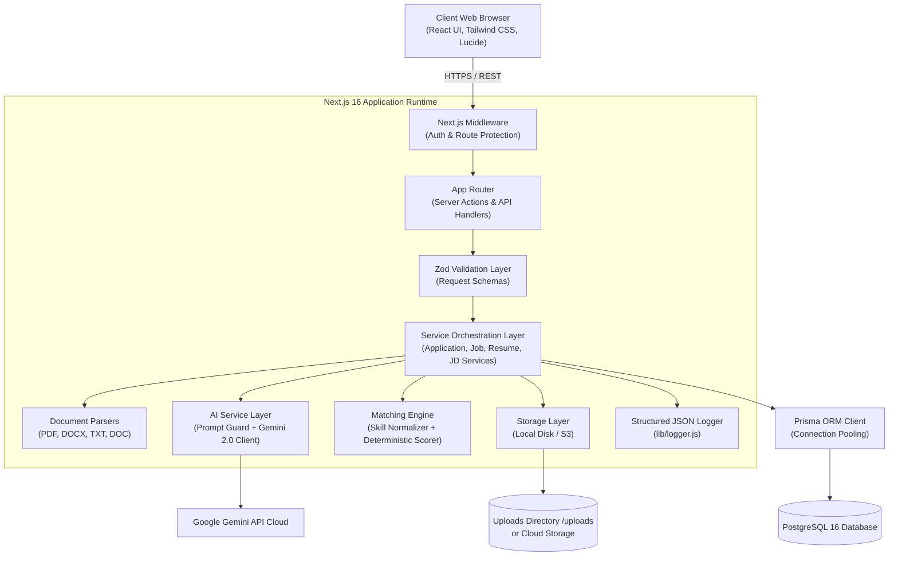

# JobOS — Master Plan

Version: 1.1  
Status: Governing architecture and product document.  
Last Updated: November 2026 (Audited against active codebase)

---

## 1. Executive Summary

JobOS is an intelligent, personal Job Search Operating System built as a unified Next.js 16 application (App Router, JavaScript/JSX) backed by PostgreSQL via Prisma ORM. It guides a job seeker through finding a role, saving it, parsing job descriptions (JDs) with Google Gemini AI, parsing multi-format resumes, computing an explainable resume↔JD match score, tracking applications through multi-stage pipelines (OA, technical interviews, offers), and viewing career analytics.

The system runs either locally (Node.js + PostgreSQL) or containerized with Docker and Docker Compose. AI extraction (Gemini API) is safely isolated behind server-side boundary layers in `lib/ai/`, guarded by prompt injection sanitization and strict Zod schema validation. The match score is never a black-box LLM hallucination: it is evaluated deterministically over normalized, structured data.

The project is structured into 11 development phases, each gated by automated unit, integration, and E2E tests, clean linting, and CI pipelines before merging to `main`.

---

## 2. Product Vision & Target Audience

### Product Vision
Provide job seekers with a single, reliable system of record that replaces fragile spreadsheets, browser bookmarks, and disconnected note files—augmenting the search process with AI for labor-intensive parsing and tailoring while keeping the user in full control of every resume claim.

### Target User
Engineers, technical professionals, and knowledge workers who:
- Concurrently track multiple applications across diverse company stages.
- Maintain multiple resume variants (e.g., Backend, Systems, Full Stack).
- Require clear, auditable gap analysis between their background and job descriptions before applying.
- Demand zero data leakage or fabricated claims on their resume.

---

## 3. Product Goals & Non-Goals

### Goals
- **Single Source of Truth**: Centralize jobs, resumes, applications, timeline events, and notes.
- **Explainable Match Scoring**: Auditable, deterministic matching algorithms instead of arbitrary LLM percentage guesses.
- **Strict Anti-Fabrication**: AI assists with structuring and drafting, but never synthesizes falsified experience or metrics.
- **Robust Ingestion**: Multi-format document parser handling PDF, DOCX, DOC, and TXT with magic-byte MIME validation.
- **Developer-Friendly DevOps**: Flexible local development, multi-stage Docker containerization, and GitHub Actions CI.

### Non-Goals (MVP Scope)
- No web scraping or external job board aggregation.
- No claim of exact ATS-clone algorithmic parity (JobOS scores job readiness and alignment, not proprietary black-box filters).
- Single-user/single-tenant architecture (no multi-tenant enterprise billing or team collaboration in MVP).
- No native mobile app (fully responsive web UI).

---

## 4. Current State vs. Target

```
[Phases 01 - 06: Completed]  ==>  [Phase 07: In Progress]  ==>  [Phases 08 - 11: Planned / Target]
- Auth & Session (Auth.js)         - Skill Normalizer (Done)       - Resume AI Assistant (Phase 08)
- Job Management & CRUD            - Match Prisma Models (Done)    - Career Analytics (Phase 09)
- Application Tracker & Timeline   - Semantic Matching (WIP)       - Notifications & Reminders (Phase 10)
- Multi-format Resume Ingestion    - 6-Category Scorer (WIP)       - Production Vercel/AWS Deploy (Phase 11)
- Gemini JD AI Extraction          - Match Analysis UI (Next)
- Docker & GitHub Actions CI
```

| Domain | Current Implemented State | Target End-State |
| :--- | :--- | :--- |
| **Authentication** | Credentials login, registration, session cookies, route protection, reset API endpoints. | Add frontend password reset UI forms, OAuth providers (GitHub/Google), live email dispatch via SES/Resend. |
| **Job Management** | Full CRUD, salary/location fields, archive toggle, 1-click convert to application. | Browser extension for 1-click job capture from LinkedIn/Indeed. |
| **Applications** | Table view, status filtering, multi-field search, pagination, events, notes, tags. | Interactive Kanban board view, drag-and-drop status pipelines. |
| **Resume Parsing** | PDF, DOCX, TXT, DOC parser dispatch, magic-byte checking, local file storage. | Async BullMQ worker queue, AWS S3 storage provider option. |
| **JD Extraction** | Gemini 2.0 Flash AI pipeline with prompt guards, schema validation, and structured output. | In-depth company profile extraction and industry keyword benchmarking. |
| **Matching Engine**| `MatchAnalysis`/`SkillGap` schema, skill normalizer with alias tables. | Full 6-category score engine, residual semantic matcher, transparent gap UI. |
| **Resume Assistant**| API route stubbed (`/api/ai/tailor-bullet`). | Anti-fabrication bullet rewriter with diff-based side-by-side approval UX. |
| **Analytics** | Schema models in place (`ApplicationStatusHistory`). | Visual conversion funnels, response rate analytics, time-to-offer charts. |
| **DevOps & Quality** | Vitest (82.5% coverage), Playwright E2E, Docker multi-stage, GitHub Actions CI, `/api/health`. | Automated production deployments to Vercel or AWS ECS with CloudWatch logging. |

---

## 5. Prioritized Roadmap

1. **Phase 07 — Resume/JD Matching Engine (Current Focus)**
   - Implement `lib/ai/matching.js` for residual semantic skill pairing.
   - Implement pure deterministic 6-category scoring algorithm (`lib/matching/score-engine.js`).
   - Wire `POST /api/match` and `/api/match/[applicationId]`.
   - Build Match Analysis UI breakdown (`/analysis/[applicationId]`) with skill gap indicators (`✓ Strong`, `~ Partial`, `✗ Missing`).

2. **Phase 08 — Resume AI Assistant**
   - Anti-fabrication prompt guardrails preventing false metric generation.
   - Bullet point optimizer and tailored suggestion service.
   - Side-by-side diff review UI with explicit manual approval.

3. **Phase 09 — Analytics & Reporting**
   - Pipeline funnel analytics (Saved → Applied → Interview → Offer conversion).
   - Time-in-stage calculations and interview velocity metrics.
   - Responsive chart visualizations.

4. **Phase 10 — Events & Notifications**
   - Scheduled event reminders (OA deadlines, technical screens).
   - In-app notification center.
   - Background reminder worker.

5. **Phase 11 — Production Hardening & Cloud Deployment**
   - Vercel or AWS deployment configuration.
   - S3 storage provider activation.
   - Rate limiting, security audit, and database backup automation.

---

## 6. Architecture & System Design



---

## 7. Engineering Standards & Conventions

1. **JavaScript & JSX Only**: Strict ESLint rule prohibiting `.ts` and `.tsx` files; all code uses standard modern JavaScript.
2. **Deterministic Domain Logic**: Heuristics, calculations, and match scores are implemented as pure, testable functions with zero network dependencies.
3. **Session-Scoped Access**: Every database query is scoped by the session user's ID. No endpoint accepts client-supplied user IDs.
4. **Resilient AI Pipeline**: LLM interactions are wrapped with timeout controls, exponential backoff retries, and schema validation. Falsified or unvalidated AI responses are rejected before persistence.
5. **Observability**: All application events, warnings, and errors emit structured JSON with timestamp, log level, and request context.
